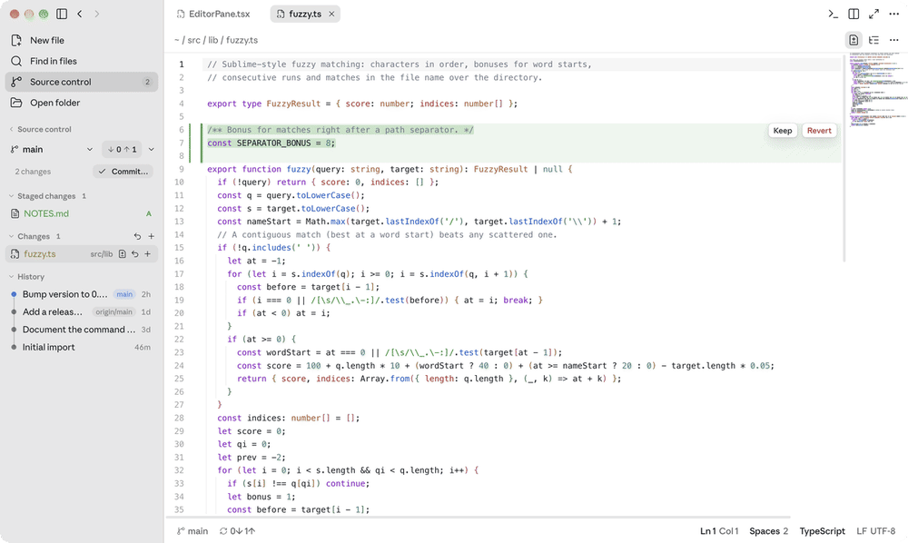
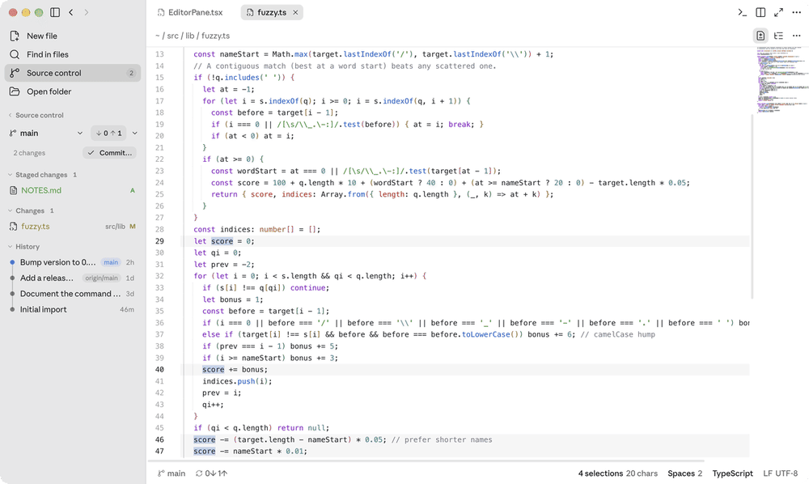
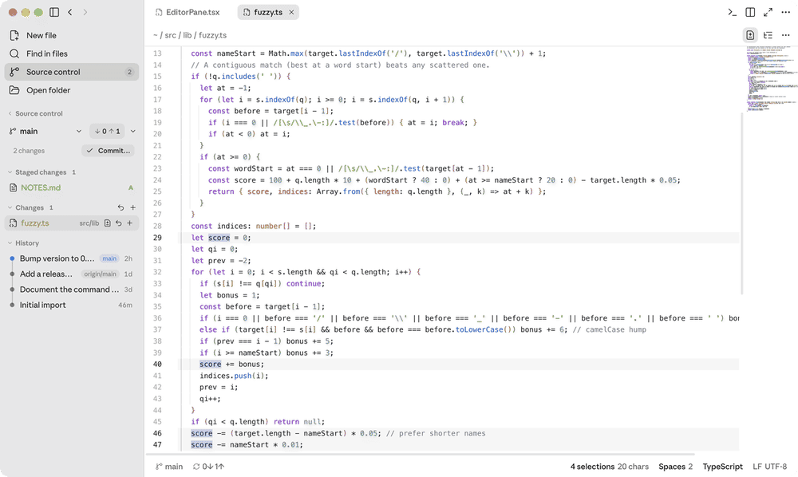
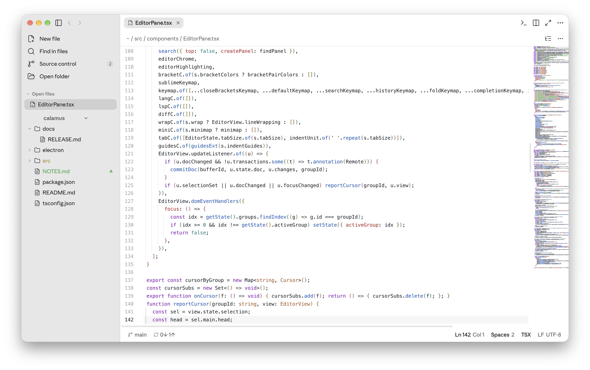
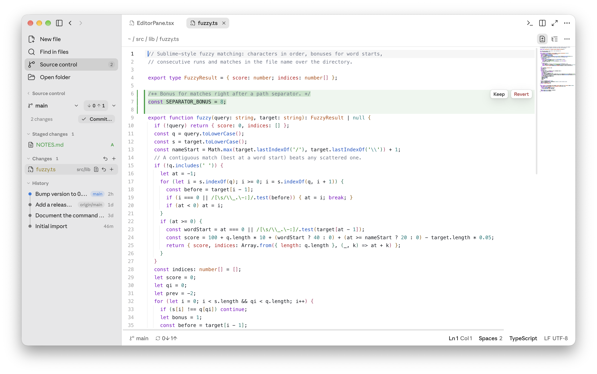
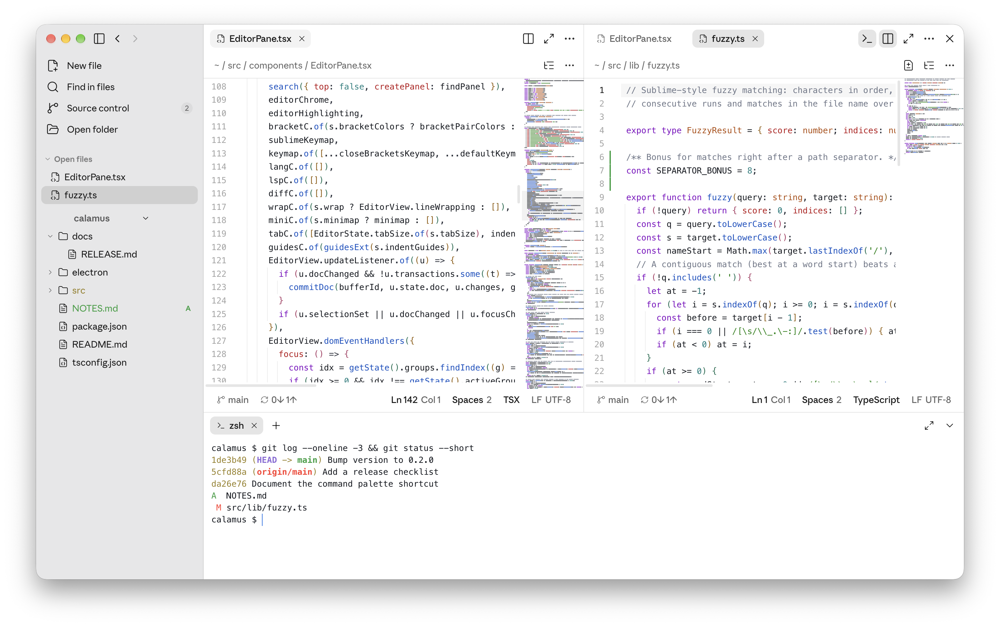
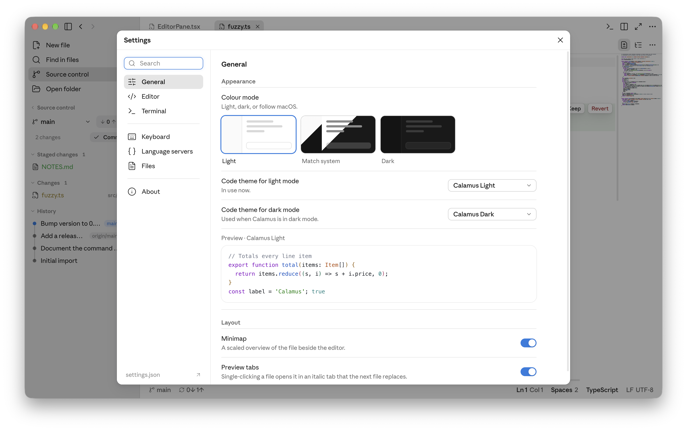
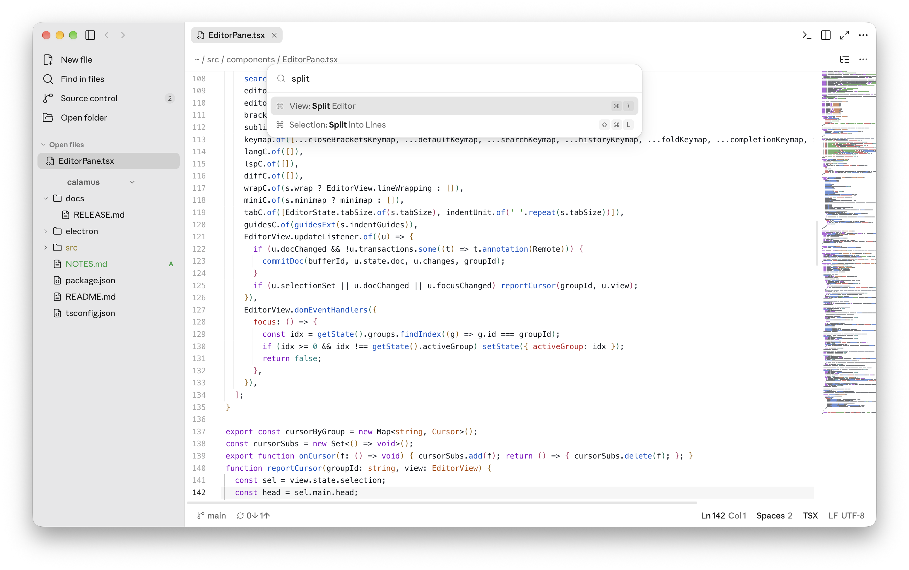
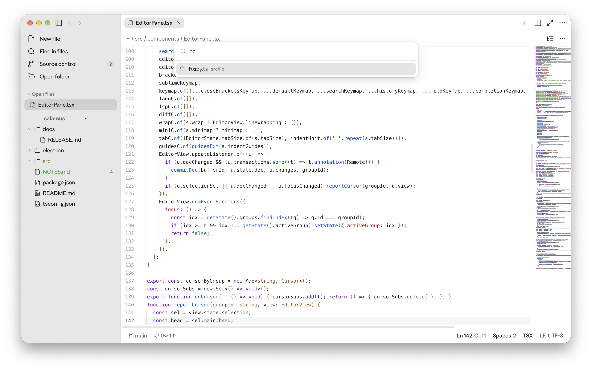
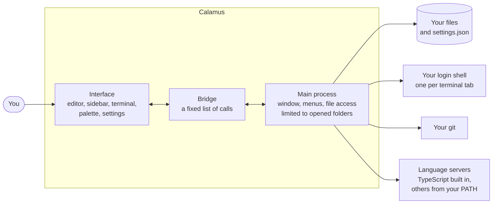

<div align="center">


# Calamus

### A calm, keyboard-first code editor for macOS, Windows and Linux.

**Goto Anything, multiple cursors, split editing, a real terminal, git and language servers, without the clutter.**

[](https://github.com/utabk/calamus/releases/latest)
[](https://github.com/utabk/calamus/actions/workflows/build.yml)
[](#themes)
[](LICENSE)

[Quick start](#quick-start) · [Features](#features) · [Screenshots](#screenshots) · [Keyboard](#keyboard) · [How it works](#how-calamus-works) · [FAQ](#faq) · [Development](#development)

</div>

<p align="center">
  
</p>

Calamus is a code editor that stays out of your way. Press ⌘P and type a few letters to open any
file. Press ⌘D to select the next match and edit them all at once. Split the window, open a
terminal, commit your changes, jump to a definition, then hide everything with ⌘B and just write.

It opens instantly on a folder, remembers your tabs and unsaved text between launches, and keeps
every setting in a plain `settings.json` you can edit by hand or from the Settings page.

## Quick start

### Download

Get the installer for your system from the [latest release](https://github.com/utabk/calamus/releases/latest):

| System | Download |
| --- | --- |
| macOS (Apple Silicon or Intel) | `.dmg` or `.zip` |
| Windows (x64 or ARM64) | `.exe` installer or `.zip` |
| Linux (x64 or ARM64) | `.AppImage`, `.deb` or `.tar.gz` |

### Run from source

You need Node.js 22 or newer and git.

```bash
git clone https://github.com/utabk/calamus.git
cd calamus
npm install
npm start              # build and open Calamus
npm start -- ~/project # open a folder on launch
```

### First five minutes

1. Open a folder with ⇧⌘O, or drop one on the window.
2. Press ⌘P, type part of a file name and press Return. Add `:42` to land on line 42, or `@name`
   to jump to a symbol.
3. Press ⇧⌘P for every command, with its shortcut next to it.
4. Press ⌃` for a terminal and ⌃⇧G for source control.
5. Press ⌘, to pick your colour mode and code themes.

## Features

### Editing

| | |
| --- | --- |
| **Goto Anything** | ⌘P: fuzzy file search. `file:12` jumps to a line, `@name` to a symbol, `:12` to a line in the current file |
| **Command Palette** | ⇧⌘P: every command, searchable, with its shortcut |
| **Multiple cursors** | ⌘D next match, ⌃⌘G all matches, ⇧⌘L split a selection into lines, ⌃⇧↑/↓ add a cursor, ⌥-drag for a column |
| **Line tools** | ⌘/ comment, ⇧⌘D duplicate, ⌃⇧K delete, ⌃⌘↑/↓ move, ⌘J join, ⌘L select line, sort, change case, trim |
| **Find** | ⌘F find and replace with case, whole word and regex. ⇧⌘F searches and replaces across the folder |
| **Split editing** | ⌘\ splits the editor. The same file in two panes stays in sync as you type |
| **Languages** | Syntax highlighting for about 150 languages, plus a live Markdown preview |
| **Minimap** | Drawn at full Retina resolution in your theme's colours |

### Source control

<p align="center">
  
</p>

- Stage, unstage and discard single files or everything at once.
- The commit box stays out of the way until you click **Commit…** or run *Git: Commit…*. With
  nothing staged, Commit takes every change.
- Switch or create branches, pull, push and sync, with incoming and outgoing counts. New branches
  publish to your remote on the first push.
- **History** lists your commits on a single line graph. Unpushed commits are marked, branch
  labels sit next to their commit, and clicking a commit shows the files it changed.
- Changed lines are marked in the gutter. The inline diff shows each change in place, with
  **Keep** and **Revert** buttons.

Calamus runs your own `git`, so your config, hooks and credential helper all apply. It never
opens a password prompt; if git needs to sign in, run the command once in the terminal.

### Terminal

⌃` opens a terminal panel with tabs, running your login shell. It follows your theme's colours,
copies on select, treats ⌥ as Meta, makes links clickable and clears with ⌘K. ⇧⌘B runs the current
file.

### Language servers

Go to definition (F12), find references (⇧F12), rename (F2), format (⇧⌥F), hover docs and inline
errors. TypeScript and JavaScript work out of the box. Rust, C and C++, Python and Go light up
when `rust-analyzer`, `clangd`, `pyright` or `gopls` is on your PATH.

### Themes

<p align="center">
  
</p>

Light, dark or follow the system, plus 67 code themes: Calamus Light and Dark and the popular
open-source ones (GitHub, One Dark Pro, Tokyo Night, Rosé Pine, Catppuccin, Dracula, Nord,
Solarized, Vitesse and more). Pick one theme for light mode and another for dark; the preview
updates as you move through the list.

### Sessions and files

- Tabs, folders and unsaved text come back after a restart.
- Files changed by other programs reload on their own. Unsaved edits are never overwritten.
- Preview tabs: a single click opens a file in an italic tab that the next click replaces.
- Line endings stay as they were, so CRLF files stay CRLF.
- Recent folders are one ⌃⌘P away.

## Screenshots

<table>
  <tr>
    <td></td>
    <td></td>
  </tr>
  <tr>
    <td align="center">Editor and minimap</td>
    <td align="center">Source control, history and inline diff</td>
  </tr>
  <tr>
    <td></td>
    <td></td>
  </tr>
  <tr>
    <td align="center">Split editor and terminal</td>
    <td align="center">Settings</td>
  </tr>
  <tr>
    <td></td>
    <td></td>
  </tr>
  <tr>
    <td align="center">Command Palette</td>
    <td align="center">Goto Anything</td>
  </tr>
</table>

## Keyboard

Shortcuts are shown for macOS. On Windows and Linux, ⌘ is Ctrl.

| Action | Keys |
| --- | --- |
| Goto Anything | ⌘P |
| Command Palette | ⇧⌘P |
| Goto line | ⌃G |
| Select next match / all matches | ⌘D / ⌃⌘G |
| Split selection into lines | ⇧⌘L |
| Find / find in files | ⌘F / ⇧⌘F |
| Split editor | ⌘\ |
| Toggle sidebar | ⌘B |
| Distraction-free mode | ⌃⇧⌘F |
| Terminal | ⌃` |
| Source control | ⌃⇧G |
| Commit (in the message box) | ⌘↩ |
| Go to definition / references | F12 / ⇧F12 |
| Rename symbol | F2 |
| Reopen closed tab | ⇧⌘T |
| Settings | ⌘, |

Every shortcut can be changed. Settings > Keyboard has a recorder, and `keybindings.json` takes
single keys and chords such as `cmd+k cmd+b`.

## How Calamus works

Calamus has two halves. The main process owns the window, the menus and everything that touches
your computer: files, terminals, git and language servers. The interface runs in a sandboxed
page that can only reach the main process through a small, fixed bridge. File access is limited
to the folders and files you opened.



The editor is built on [CodeMirror 6](https://codemirror.net), the terminal on
[xterm.js](https://xtermjs.org) and [node-pty](https://github.com/microsoft/node-pty), and the
interface on [React](https://react.dev). Icons are [Lucide](https://lucide.dev).

## Settings

The Settings page (⌘,) and `settings.json` are two views of the same file, and comments are
allowed. Saved changes apply right away.

```jsonc
{
  "theme": "system",            // "light", "dark" or "system"
  "codeThemeLight": "github-light",
  "codeThemeDark": "tokyo-night",
  "minimap": true,
  "languageServers": true
}
```

Open it from Settings > `settings.json`, or with *Preferences: Open settings.json* in the
Command Palette.

## FAQ

**Which fonts does Calamus use?**
The interface uses your system font (SF Pro on macOS, Segoe UI on Windows). Code uses SF Mono by
default; JetBrains Mono and Menlo are in Settings > Editor. No font files are bundled. To use
another installed font for the interface, set `"uiFont"` (and `"headingFont"` for headings) in
`settings.json`.

**Does Calamus send anything over the network?**
No. There's no telemetry and no account. The network is only used when you ask for it, for
example by running `git push`.

**Why does my system warn me the first time I open it?**
Release builds are signed for macOS when a certificate is available; Windows and Linux builds
aren't signed yet. On Windows, choose *More info* then *Run anyway*. On macOS, if you see a
warning, Control-click Calamus in Applications and choose *Open*.

**Git asks for a password and nothing happens.**
Calamus runs git without prompts so it can never hang. Run `git push` once in the terminal (⌃`)
to sign in, or set up an SSH key or a credential helper, then try again.

**Can I use my own language server?**
Calamus starts `rust-analyzer`, `clangd`, `pyright` and `gopls` when they're on your PATH, and
turns them off with `"languageServers": false`.

## Development

```bash
npm install
npm run dev            # hot reload
npm start              # production build
npm run web            # interface only, in a browser, with a sample project (localhost:5199)
npm run selftest       # end-to-end test: files, watcher, terminal, git, history, language server
```

`npm install` also fetches the desktop runtime and makes the terminal helper executable, since
npm 11 skips dependency install scripts.

### Project layout

```text
electron/       main process: window, menus, files, terminals (pty.cjs), git (git.cjs),
                language servers (lsp.cjs), settings files (userfiles.cjs), and the bridge (preload.cjs)
src/store.ts    buffers, editor groups, settings and session
src/commands.ts every command, used by the palette, the menus and shortcuts
src/components/ sidebar, editor groups and panes, source control, terminal, settings, dialogs
src/lib/        minimap, git gutter, language client, key bindings, code themes
src/styles/     design tokens (light and dark) and the stylesheet
```

### Building installers

| Command | Output |
| --- | --- |
| `npm run dist` | macOS `.dmg` and `.zip` |
| `npm run dist:dir` | macOS `.app` only, faster |
| `npm run dist:win` | Windows installer and `.zip` (best built on Windows or in CI) |
| `npm run dist:linux` | `.AppImage`, `.deb`, `.tar.gz` (build on Linux; the terminal module compiles there) |

Builds go to `release.nosync/`. `.github/workflows/build.yml` builds every platform on its own
runner. Run it from the Actions tab to get the installers as artifacts, or push a tag
(`git tag v0.1.0 && git push --tags`) to create a draft release with all of them attached.

### Signing

`npm run dist` signs macOS builds with the Developer ID certificate in your keychain, using the
hardened runtime and `build/entitlements.mac.plist`. In CI, add the certificate as the
`CSC_LINK` and `CSC_KEY_PASSWORD` secrets; without them the macOS build is unsigned.
Notarization is off. To turn it on, set `build.mac.notarize` to `true` and provide
`APPLE_ID`, `APPLE_APP_SPECIFIC_PASSWORD` and `APPLE_TEAM_ID`.

## Contributing

Bug reports and pull requests are welcome. [CONTRIBUTING.md](CONTRIBUTING.md) explains how to
set up, test and send a change, and [SECURITY.md](SECURITY.md) how to report a vulnerability
privately.

## License

[MIT](LICENSE). Code themes other than Calamus Light and Dark come from
[`@shikijs/themes`](https://github.com/shikijs/textmate-grammars-themes) (MIT), and each keeps its
own author's license.
